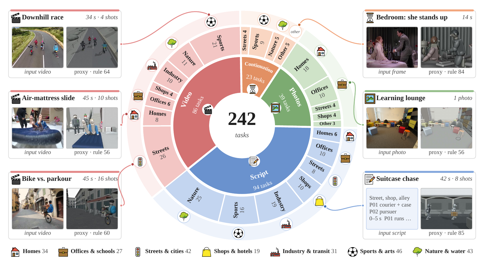

# VibePrevisBench: Evaluating Agentic Coding for 4D Scene Directing in Blender

Official project repository: **[vibeprevisbench/vibeprevisbench](https://github.com/vibeprevisbench/vibeprevisbench)**. This repository publishes the project website.

<p align="center">
  <a href="https://vibeprevisbench.github.io/"></a>
  <a href="./VibePrevisBench.pdf"></a>
  <a href="#paper"></a>
  <a href="#code-and-data"></a>
  <a href="#code-and-data"></a>
</p>

<p align="center">
  <a href="https://vibeprevisbench.github.io/">
    <picture>
      <source media="(prefers-color-scheme: dark)" srcset="./assets/img/readme-brand-dark.svg">
      <source media="(prefers-color-scheme: light)" srcset="./assets/img/readme-brand-light.svg">
      
    </picture>
  </a>
</p>

<p align="center">
  <a href="https://vibeprevisbench.github.io/#benchmark">Benchmark overview</a> ·
  <a href="https://vibeprevisbench.github.io/#leaderboard">Leaderboard</a> ·
  <a href="https://vibeprevisbench.github.io/#gallery">Case studies</a>
</p>

## 💥 News

- **[2026.11.03]** 📄 **Our paper is now available:** [VibePrevisBench: Evaluating Agentic Coding for 4D Scene Directing in Blender](./VibePrevisBench.pdf).
- 🌐 The [project homepage](https://vibeprevisbench.github.io/) is live, with benchmark results, an interactive leaderboard, and case studies.

## 👀 About VibePrevisBench

**Can a coding agent turn a brief into a 4D scene that a director can use?**

VibePrevisBench evaluates agentic coding for **4D scene directing in Blender**.
Given a script, a few photos, a first frame, or real footage, an agent writes and
runs code, renders previews, inspects its frames, and delivers an executable
greybox scene: who is where, when they move, how each shot is framed, and where
the cuts happen.

<p align="center">
  
</p>

*Figure 3 from our paper. The benchmark contains 242 tasks across four input
kinds. The ring shows the input kinds and scene domains; six examples pair the
reference input with GPT-6 Astra's proxy and rule score.*

- **242 tasks across four input types:** 94 scripts, 39 photo-based tasks,
  23 first-frame continuation tasks, and 86 video-based tasks.
- **84,406 scorable facts** covering spatial layout, actions, cameras, and physics.
- **11 evaluated agents**, compared with deterministic rule checks and visual evaluation.
- **14 interactive case studies**, with reference inputs, agent proxy videos,
  and 3D scenes for side-by-side inspection.

Explore the [benchmark overview](https://vibeprevisbench.github.io/#benchmark),
compare agents on the [live leaderboard](https://vibeprevisbench.github.io/#leaderboard),
or inspect [scene-specific results](https://vibeprevisbench.github.io/#scenes).

### Evaluation Environment

Each task is run once in a fresh, isolated sandbox. The agent writes and runs
Blender Python, renders previews, inspects its frames, and revises within the
same fixed budget. GPT models use **Codex CLI**; all other models use
**Claude Code** (paper, Sections 4.1 and 5.1).

| Setting | Evaluation protocol |
| --- | --- |
| Scene engine | **Blender 5.2** |
| Compute per run | **8 CPU cores; no GPU** |
| Time budget | **4 hours per task** |
| Isolation | Fresh sandbox; no external assets or network; no access to the scorer |
| Delivery checks | **21 automatic checks** across three gates: code runs, video renders in full, scene reopens |
| Replay | Re-run the delivered program in a fresh sandbox, export scene state frame by frame, and render the proxy at **24 fps** |
| Scoring | Deterministic rule checks plus a **Gemini 4** visual judge; overall = ½ rule + ½ VLM |

```text
Task brief + optional photos / first frame / reference video
                            |
                            v
        +---------------------------------------------+
        | Coding agent: Codex CLI / Claude Code       |
        | Blender 5.2 sandbox                         |
        | 8 CPU cores · no GPU · 4 hours              |
        |                                             |
        | write code -> render -> inspect -> revise   |
        +---------------------------------------------+
                            |
                            v
             Delivery validation (21 checks)
                            |
                            v
         Fresh sandbox: replay -> export -> render
                            |
              +-------------+-------------+
              v                           v
      Rule scorer on GT           Gemini 4 on proxy
              +-------------+-------------+
                            v
                  Overall = ½ rule + ½ VLM
```

The evaluator scores its own replay of the submitted program. An agent's preview
renders are not scored. A run without a valid delivery receives **0 on both scores**.

<details>
<summary>Evaluated models and reasoning effort</summary>

| Model | Agent CLI | Reasoning effort |
| --- | --- | --- |
| GPT-6 Astra | Codex CLI | max |
| GPT-6.1 Sol | Codex CLI | max |
| Gemini 4 Argon | Claude Code | high |
| Opus 5.5 | Claude Code | high |
| GPT-5.6 Sol | Codex CLI | max |
| DeepSeek V4.1 Flash | Claude Code | max |
| Kimi K3 | Claude Code | xhigh |
| Gemini 3.8 Flash | Claude Code | high |
| GLM 5.3 Flash | Claude Code | high |
| Doubao Seed 2.1 Pro | Claude Code | max |
| Muse Spark 1.3 | Claude Code | xhigh |

</details>

## Code and Data

**Coming soon — we will open-source the VibePrevisBench dataset and benchmark/evaluation code.**

| Resource | Status |
| --- | --- |
| Benchmark dataset | **Coming soon** |
| Benchmark and evaluation code | **Coming soon** |
| Project website, public summaries, results, and case studies | [Available now](https://vibeprevisbench.github.io/) |

This repository currently hosts the project website and its published summaries
and media. The full benchmark implementation and task dataset are being prepared
for release. We will add the download links and instructions here when they are
available.

## Paper

**[Read the paper (PDF)](./VibePrevisBench.pdf)** — VibePrevisBench: Evaluating Agentic Coding for 4D Scene Directing in Blender.

arXiv: coming soon.

## 📊 Evaluation

Each submission must pass three delivery gates: its code runs, its video renders
in full, and its Blender scene reopens correctly. A failed gate gives the task
a score of zero.

Valid submissions receive two complementary scores:

- **Rule score:** deterministic checks of exported scene facts against ground truth.
- **VLM score:** a visual judge checks whether those facts can be seen in the
  rendered proxy video.

The overall score is **50% rule score + 50% VLM score**, averaged equally across tasks.

## Website Source

<details>
<summary>Local preview and repository contents</summary>

The website is static HTML, CSS, and JavaScript. With Git and Python 3 installed:

```sh
git clone https://github.com/vibeprevisbench/vibeprevisbench.github.io.git
cd vibeprevisbench.github.io
python3 -m http.server 8765
```

Open [http://localhost:8765/](http://localhost:8765/). An internet connection is
needed for third-party JavaScript libraries loaded from CDNs.

| Path | Contents |
| --- | --- |
| `index.html` | Homepage, benchmark overview, evaluation protocol, and section layout |
| `css/` | Website styles and themes |
| `js/` | Interactive charts, case viewer, language support, and video controls |
| `data/` | Published benchmark summaries, results, and case-study metadata |
| `assets/` | Website images, videos, and 3D scene assets |
| `robots.txt`, `sitemap.xml` | Search-engine discovery files |

The site is published at [vibeprevisbench.github.io](https://vibeprevisbench.github.io/).
Keep the Google verification HTML file and verification metadata in place when
updating the site.

</details>

## Reference Media and Feedback

Reference videos and images remain the property of their original creators.
They are displayed for non-commercial academic research, with source links on
the website. For corrections, website issues, or a rights-holder removal request,
please [open an issue](https://github.com/vibeprevisbench/vibeprevisbench/issues).
